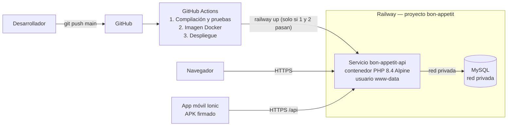

# Laboratorio 14 — Arquitectura de despliegue

Despliegue de **Bon Appétit** (back-end Laravel 13 + front-end web) en un entorno operativo
accesible desde Internet, con contenerización, base de datos administrada e integración y
entrega continuas.

- **URL pública:** <!-- COMPLETAR --> `https://<dominio>.up.railway.app`
- **Verificación de estado:** `GET /up` → 200
- **Plataforma:** Railway (contenedor Docker + MySQL administrado, HTTPS con certificado válido)

## 1. Arquitectura

| Componente | Dónde corre | Notas |
|---|---|---|
| Front-end web (Blade + Vite + Tailwind) | Dentro del mismo contenedor que el back-end | Se compila en la etapa `assets` del Dockerfile (`npm run build`) y se sirve desde `public/build` |
| Back-end / API REST (Laravel 13) | Servicio `bon-appetit-api` en Railway | Contenedor Docker, puerto 8080, HTTPS lo termina el proxy de Railway |
| Base de datos | Servicio MySQL administrado de Railway | Solo accesible por red privada (`*.railway.internal`), no expuesta a Internet |
| App móvil | Dispositivo del usuario | APK firmado que apunta a `https://<dominio>/api` |

## 2. Configuración por entornos

- **Desarrollo:** `.env` local (en `.gitignore`, nunca se sube), SQLite/MySQL de Laragon, `APP_DEBUG=true`.
- **Producción:** variables de entorno definidas **solo en Railway**. La plantilla sin valores
  está en `.env.production.example`.
- Ninguna credencial está en el código ni en el repositorio: la contraseña de la base de datos se
  inyecta como referencia de Railway (`${{MySQL.MYSQLPASSWORD}}`) y el token de despliegue vive
  como *secret* de GitHub (`RAILWAY_TOKEN`).
- **Falla explícita ante configuración ausente:** `docker/entrypoint.sh` revisa al arrancar que
  existan `APP_KEY`, `APP_URL`, `DB_CONNECTION`, `DB_HOST`, `DB_PORT`, `DB_DATABASE`,
  `DB_USERNAME` y `DB_PASSWORD`; si falta alguna, el contenedor termina con error y no arranca.
  Además rechaza `APP_DEBUG=true` cuando `APP_ENV=production` (valor por omisión inseguro).
  El pipeline lo verifica en cada ejecución (paso *"Falla explícita sin configuración"*).

## 3. Empaquetado y contenerización

`Dockerfile` con construcción en **múltiples etapas**:

| Etapa | Imagen base | Qué hace | ¿Llega a la imagen final? |
|---|---|---|---|
| `assets` | `node:22-alpine` | `npm ci` + `npm run build` (Vite) | Solo `public/build` |
| `php-base` | `php:8.4-cli-alpine` | Extensiones `pdo_mysql`, `intl`, `bcmath`, `opcache` | Sí (es la base) |
| `vendor` | `php-base` + Composer | `composer install --no-dev` + autoload optimizado | Solo la app + `vendor/` sin paquetes de desarrollo |
| `runtime` | `php-base` | Imagen final | — |

- **Imagen mínima:** Alpine; Node, npm y Composer no están en la imagen final.
- **Usuario sin privilegios:** la etapa final hace `USER www-data`; el contenedor nunca corre como root
  (el pipeline lo comprueba con `docker run --entrypoint id`).
- `.dockerignore` excluye `.env`, `.git`, `node_modules`, `vendor`, `mobile/`, `tests/` y `docs/`
  del contexto de build.

### Tamaño de los artefactos

| Artefacto | Tamaño | Fuente |
|---|---|---|
| Build del front-end (`public/build`) | <!-- COMPLETAR --> | Log del paso *"Build optimizado del front-end"* |
| Imagen Docker final | <!-- COMPLETAR --> | Log del paso *"Tamaño de la imagen y usuario de ejecución"* |
| APK firmado (`app-release.apk`) | <!-- COMPLETAR --> | `mobile/android/app/release/` |

## 4. Arranque del contenedor y migraciones

`docker/entrypoint.sh`, en este orden:

1. Valida la configuración obligatoria (ver sección 2).
2. Ejecuta `php artisan migrate --force` (solo migraciones pendientes; reintenta hasta 5 veces
   si MySQL todavía está levantando).
3. Si `SEED_ON_BOOT=true` (solo el primer despliegue), carga roles, usuarios, categorías,
   productos, catálogos y mesas. Las comandas de ejemplo no se cargan en producción porque
   usan Faker, que es dependencia de desarrollo.
4. `php artisan config:cache`.
5. Levanta el servidor HTTP de PHP con 4 *workers* (`PHP_CLI_SERVER_WORKERS=4`) en el puerto 8080.

`railway.json` configura la verificación de estado contra `/up` y el reinicio automático ante fallo.

## 5. Integración y entrega continuas

`.github/workflows/ci-cd.yml`, en cada push a `main`:

1. **Compilación y pruebas:** `composer install`, `npm run build`, `php artisan test` (Pest, SQLite en memoria).
2. **Imagen Docker:** construye la imagen multi-etapa, reporta su tamaño, comprueba que corre como
   `www-data` y que se niega a arrancar sin configuración.
3. **Despliegue:** `railway up` al servicio `bon-appetit-api`. Solo se ejecuta si los dos trabajos
   anteriores terminaron bien: **una prueba fallida detiene el despliegue.**

El servicio de Railway **no** está conectado al auto-deploy de GitHub: la única vía para desplegar
es el pipeline, así ningún cambio llega a producción sin pasar las pruebas.

**Evidencia de detención:** el workflow se puede disparar a mano (*Run workflow*) con
`simular_fallo = true`; eso hace fallar `tests/Feature/CompuertaCiTest.php` y el trabajo de
despliegue queda como *skipped*, sin tener que subir código roto a `main`.

| Ejecución | Resultado | Enlace |
|---|---|---|
| Exitosa (compila, pasa pruebas, despliega) | ✅ | <!-- COMPLETAR --> |
| Detenida por prueba fallida (despliegue omitido) | ❌ | <!-- COMPLETAR --> |

## 6. Verificación del despliegue

| Verificación | Cómo | Resultado esperado |
|---|---|---|
| Responde públicamente | Abrir `https://<dominio>/login` | Página de login |
| Certificado válido | Candado del navegador | Certificado emitido para `*.up.railway.app` |
| Verificación de estado | `curl -i https://<dominio>/up` | `200` |
| API funcionando | `curl https://<dominio>/api/productos` | JSON con productos |
| Variables sensibles no expuestas | `https://<dominio>/.env` | `404` (el servidor solo publica `public/`) |
| Sin modo depuración | Pedir una ruta inexistente de la API | JSON `404` limpio, sin traza de pila |

## 7. Aplicación móvil firmada

1. `mobile/.env` → `VITE_API_URL=https://<dominio>/api`
2. `npm run build && npx cap sync android`
3. Android Studio → *Build → Generate Signed App Bundle or APK → APK* → llave nueva (`.jks`)
   guardada **fuera del repositorio** → variante `release`.
4. Resultado: `mobile/android/app/release/app-release.apk`.

El archivo de la llave y sus contraseñas no se suben al repositorio (`*.jks`, `*.keystore` y
`keystore.properties` están en `mobile/.gitignore`).

## 8. Decisiones y limitaciones

- **Servidor HTTP:** se usa el servidor integrado de PHP con varios *workers* por simplicidad
  (un solo proceso, sin supervisor). Para mayor carga, el siguiente paso sería Nginx + PHP-FPM o
  FrankenPHP; el resto de la arquitectura no cambia.
- **Front-end y back-end en el mismo contenedor:** el front-end web son vistas Blade con assets de
  Vite, así que se sirven desde la misma app Laravel; se despliegan juntos pero se construyen en
  etapas separadas.
- **Base de datos en desarrollo vs. producción:** desarrollo usa SQLite/MySQL local; producción usa
  MySQL administrado. Las pruebas del pipeline corren sobre SQLite en memoria.
